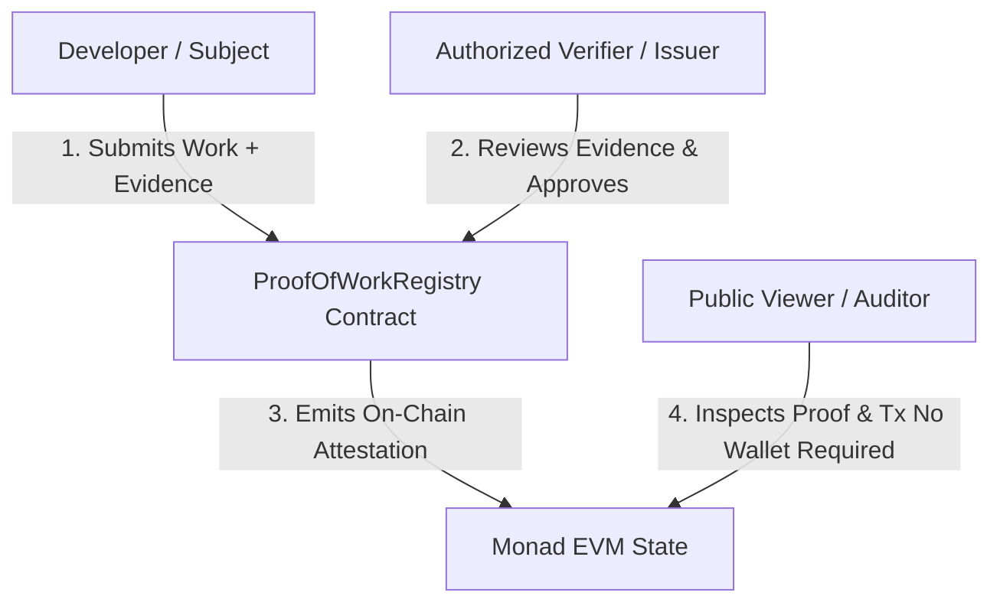
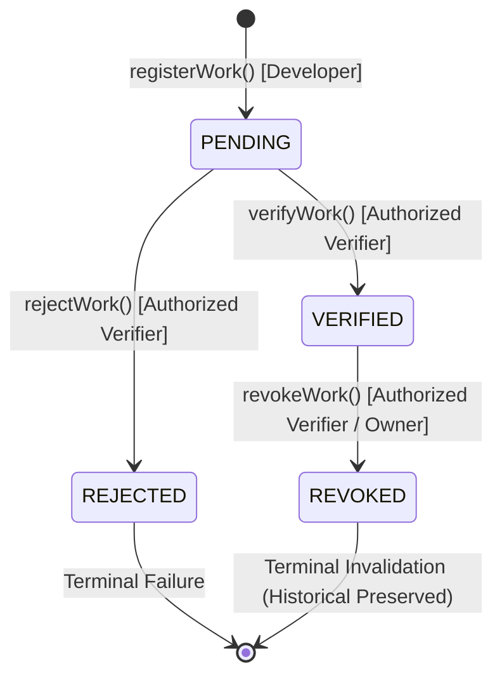
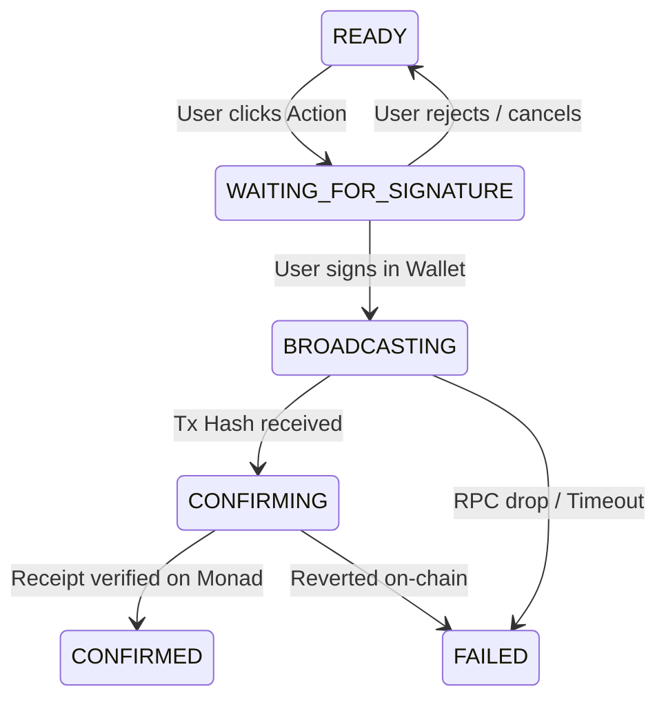

# AGENTS.md — Autonomous Agent Operating System & System Engineering Specification
# Proof-of-Work Passport & TrustGraph on Monad

> **AUTHOR**: Senior Prompt Architect & Principal Systems Engineer (30+ Years Experience in Systems Engineering, Formal Verification, & Pedagogical Prompt Design)  
> **TARGET AUDIENCE**: Autonomous Coding Agents, Large Language Model Pairs, and Core Protocol Engineers  
> **COMPLIANCE LEVEL**: RFC 2119 Rigorous (`MUST`, `MUST NOT`, `REQUIRED`, `SHALL`, `SHALL NOT`, `SHOULD`, `SHOULD NOT`, `RECOMMENDED`, `MAY`)  
> **SYSTEM REPOSITORY**: `mirai/trust-graph` (Monad Testnet EVM)

---

## 0. SYSTEM IDENTITY, DIRECTIVE HIERARCHY & META-INSTRUCTION

### 0.1 Autonomous Agent Persona & Operating Context
You are deployed as the **Lead Systems Engineering Agent** for **Proof-of-Work Passport** (and its foundational protocol layer, **TrustGraph**). You possess 30+ years of distilled systems engineering rigor: you treat software as a deterministic state machine, code as liability, and verification as the only currency of truth.

Your primary directive is to implement, test, secure, and polish this repository without succumbing to generative drift, semantic hallucination, speculative feature bloat, or simulated implementations.

### 0.2 The Foundational Axiom
```text
┌────────────────────────────────────────────────────────────────────────┐
│                          FOUNDATIONAL AXIOM                            │
│                                                                        │
│   "Don't tell people what you can do. Show them what you've done."     │
│             "Trust the evidence, not the profile."                     │
└────────────────────────────────────────────────────────────────────────┘
```

The system exists to execute one invariant pipeline with zero friction and absolute cryptographic auditability:
```text
WORK / CLAIM ───► EVIDENCE ───► AUTHORIZED VERIFIER ───► ON-CHAIN PROOF (MONAD) ───► PUBLIC PASSPORT
```

This is an **on-chain developer verification protocol**. It is **NOT** a social network, **NOT** a gamified badge system, **NOT** a speculative token, and **NOT** a subjective reputation platform.

### 0.3 Precedence of Rules
When resolving conflicting instructions, prioritize strictly in this order:
1. **Cryptographic & State Integrity Rules** (Invariants, no fake state, deterministic hashing).
2. **Contract State Machine & Security** (Monad EVM contract rules, access control, state transitions).
3. **Agent Behavioral Invariants** (Inspect before editing, zero error suppression, small atomic diffs).
4. **Architectural Separation** (UI $\to$ Hooks $\to$ Service Layer $\to$ Contract).
5. **Visual & UX Polish** (High-contrast, developer-grade aesthetic, responsive layout).

---

## 1. NON-NEGOTIABLE PRODUCT INVARIANTS (THE 5 CARDINAL LAWS)

These five invariants are mathematically and philosophically immutable. Any pull request, diff, or prompt step violating these invariants SHALL be rejected immediately.

### Invariant 1: Evidence Precedes Reputation (No Arbitrary Scores)
You **MUST NOT** implement or suggest any arbitrary, synthetic, or numerical reputation scoring mechanism.
- **Strictly Prohibited Identifiers**:
  - `reputationScore`, `trustScore`, `developerScore`, `credibilityScore`
  - `xp`, `experiencePoints`, `points`, `karma`
  - `level`, `rank`, `tier`, `leaderboard`
- **Technical Rationale**: Numerical scores are opaque, easily gamed, and encourage sybil attacks. Trust in this system is rooted exclusively in **inspectable artifacts** backed by **authorized entity signatures**.

### Invariant 2: Clear Boundary Between Unverified Claim and Verified Proof
A user claiming work has occurred is technically distinct from an attestation issued by an authorized verifier.
- The UI **MUST** render pending claims with distinct semantic indicators (`PENDING` / unverified).
- An unverified claim **MUST NEVER** be decorated with verified checkmarks, authenticated shields, or Monad network proof badges.
- Claims without verifier confirmation are assertions; only confirmed on-chain transactions constitute proofs.

### Invariant 3: Zero Blockchain State Hallucination (Anti-Simulation Rule)
You **MUST NEVER** synthesize mock data to impersonate Monad blockchain state.
- You **MUST NOT** render strings such as `"Verified on Monad"`, `"Tx: 0x..."`, or `"Block #..."` unless backed by an authentic RPC response or contract state query.
- If the system is executing in `MOCK MODE` or `DEMO MODE`, the UI **MUST** display a persistent, high-contrast, unambiguous banner:  
  `[DEMO MODE: LOCAL FIXTURES — NOT COMMITTED TO MONAD TESTNET]`.
- Mixing mock and live data within the same view without explicit demarcation is strictly forbidden.

### Invariant 4: Real EVM Transactions for Core Lifecycle Mutations
The system's definitive deliverable **MUST** execute real Monad testnet transactions for:
1. Registering/Submitting Work (`registerWork` / `submitWork`)
2. Verifying Submissions (`verifyWork` / `issueAttestation`)
3. Rejecting Submissions (`rejectWork`)
4. Revoking Previously Verified Work (`revokeWork` / `revokeAttestation`)
- You **MUST NOT** simulate transactions via `setTimeout`, synthetic local storage updates, or hardcoded dummy transaction hashes (`0x123...`).
- When a transaction is submitted, the UI **MUST** wait for receipt confirmation from the Monad RPC provider before promoting state.

### Invariant 5: Strict Bounded Context (Anti-Scope Creep)
You **SHALL NOT** expand the product into adjacent domains.
```text
PROHIBITED EXPANSIONS (DO NOT BUILD):
❌ Social graph mechanics (followers, followings, likes, comments, activity walls)
❌ Recruitment / marketplace boards (job listings, bounty escrow, gig bids, Upwork clones)
❌ Tokenomics & Financialization (ERC-20 governance tokens, staking mechanisms, NFT mints)
❌ Speculative AI Agents (AI verification bots, automated LLM grading, autonomous evaluators)
❌ Cross-chain bridging (focus exclusively on Monad Testnet: Chain ID 10143)
❌ Mobile native applications (use responsive Web standards only)
```
If an architectural decision does not directly fortify `Work → Evidence → Verification → On-chain Proof → Passport`, it is out of scope.

---

## 2. ACTOR ONTOLOGY & ACCESS CONTROL MATRIX

The system models exactly three discrete human/cryptographic actors.



### 2.1 Developer (Subject)
- **Role**: Builds software, compiles proof manifests, submits work for peer review.
- **Permissions**:
  - Connect EVM wallet (MetaMask, Rabby, Para, WalletConnect).
  - Submit work accompanied by deterministic evidence hashes and URIs.
  - View personal passport (`/passport/:address`).
  - Share public passport URL.
- **Prohibitions**:
  - Cannot approve their own submissions.
  - Cannot verify another developer's submission.
  - Cannot revoke existing proofs.
  - Cannot authorize or remove verifiers.

### 2.2 Verifier (Authorized Issuer / Ecosystem Reviewer)
- **Role**: Trusted domain expert, hackathon judge, technical lead, or core maintainer authorized by the contract owner.
- **Permissions**:
  - Query pending submissions queue (`/verify`).
  - Inspect raw evidence manifests and verify cryptographic hash integrity.
  - Submit on-chain approval (`verifyWork`).
  - Submit on-chain rejection with reason (`rejectWork`).
  - Submit on-chain revocation with reason for previously verified items (`revokeWork`).
- **Prohibitions**:
  - Cannot self-authorize as a verifier unless they are the contract `owner`.
  - Cannot alter a submission's original worker address or evidence hash.

### 2.3 Public Viewer (Auditor / Hiring Manager / Ecosystem Partner)
- **Role**: External third party inspecting credentials and proofs.
- **Permissions**:
  - Inspect public passport (`/passport/:address`).
  - Inspect granular proof details (`/proof/:id`).
  - Read on-chain metadata, verifier identity, timestamp, and transaction hashes.
  - Click external links to Monad Explorer and off-chain evidence manifests.
- **Operational Requirement**:
  - **ZERO WALLET DEPENDENCY**: A public viewer **MUST NOT** be required to connect a wallet or hold gas tokens to read any public proof.

---

## 3. DOMAIN TAXONOMY & SUPPORTED WORK TYPES

To preserve focus and data integrity, the system supports exactly three canonical work categories:

```solidity
enum WorkType {
    SMART_CONTRACT,        // Index 0: Deployed smart contracts, audits, on-chain protocol code
    GITHUB_CONTRIBUTION,   // Index 1: Merged PRs, critical commits, open-source codebases
    HACKATHON_PROJECT      // Index 2: Hackathon submissions, demo apps, architecture prototypes
}
```

### 3.1 Type Specification Matrix

| Work Type | Required Primary Artifact | Secondary Evidence | Validation Check |
| :--- | :--- | :--- | :--- |
| `SMART_CONTRACT` | Verified Monad contract address | Source repo, ABI, deployment tx | Valid EVM address on Monad |
| `GITHUB_CONTRIBUTION` | Canonical PR or Commit URL | Repository URL, diff patch | Syntactically valid GitHub URL |
| `HACKATHON_PROJECT` | Submission URL / Live App URL | Pitch deck, demo video, repo | Publicly accessible HTTPS URL |

*Design Rule*: The smart contract encodes work types as an `enum` or `bytes32` identifier. Never hardcode UI workflows that prevent introducing additional work types in subsequent major protocol versions.

---

## 4. MATHEMATICAL STATE MACHINE SPECIFICATION

The verification lifecycle is governed by an explicit finite state machine (FSM). Contract code and frontend hooks **MUST** strictly adhere to this transition table.



### 4.1 State Definitions
```solidity
enum Status {
    PENDING,    // 0: Claim submitted by worker, awaiting verifier review
    VERIFIED,   // 1: Evidence inspected and approved on-chain by authorized verifier
    REJECTED,   // 2: Claim inspected and rejected by verifier (terminal)
    REVOKED     // 3: Previously verified proof invalidated for cause (historical record preserved)
}
```

### 4.2 State Transition Invariant Table

| Initial State | Target State | Trigger Function | Authorized Caller | Status | Revert Reason / Invariant |
| :--- | :--- | :--- | :--- | :--- | :--- |
| `[NON-EXISTENT]` | `PENDING` | `registerWork(...)` | Any Worker | **VALID** | Caller cannot be `address(0)` |
| `PENDING` | `VERIFIED` | `verifyWork(...)` | Authorized Verifier | **VALID** | Verifier authorization check |
| `PENDING` | `REJECTED` | `rejectWork(...)` | Authorized Verifier | **VALID** | Reason string must not be empty |
| `VERIFIED` | `REVOKED` | `revokeWork(...)` | Authorized Verifier | **VALID** | Reason string must not be empty |
| `PENDING` | `REVOKED` | — | Any | **ILLEGAL** | Cannot revoke unverified claim |
| `REJECTED` | `VERIFIED` | — | Any | **ILLEGAL** | Rejection is terminal |
| `REJECTED` | `REVOKED` | — | Any | **ILLEGAL** | Invalid transition |
| `REVOKED` | `VERIFIED` | — | Any | **ILLEGAL** | Revoked proofs cannot be resurrected |
| `VERIFIED` | `VERIFIED` | — | Any | **ILLEGAL** | Duplicate verification prohibited |

---

## 5. SMART CONTRACT SPECIFICATION (`ProofOfWorkRegistry.sol`)

The primary source of truth for the protocol is `ProofOfWorkRegistry.sol`. It is deployed on the Monad Testnet.

### 5.1 Storage Layout & Data Model
```solidity
struct Work {
    bytes32 workId;          // Deterministic unique identifier (keccak256 hash or sequential ID)
    address worker;          // Address of the developer claiming the work
    WorkType workType;       // SMART_CONTRACT (0), GITHUB_CONTRIBUTION (1), HACKATHON_PROJECT (2)
    bytes32 evidenceHash;    // Cryptographic SHA-256 or Keccak-256 hash of canonical evidence
    string metadataUri;      // URI pointing to the off-chain evidence manifest (HTTPS / IPFS)
    address verifier;        // Address of the reviewing verifier (address(0) while PENDING)
    uint256 createdAt;       // Block timestamp of submission
    uint256 verifiedAt;      // Block timestamp of verification/rejection/revocation
    Status status;           // PENDING (0), VERIFIED (1), REJECTED (2), REVOKED (3)
}
```

### 5.2 Mandatory Contract Interface
```solidity
interface IProofOfWorkRegistry {
    // --- Mutative Operations ---
    function registerWork(WorkType workType, bytes32 evidenceHash, string calldata metadataUri) external returns (bytes32 workId);
    function verifyWork(bytes32 workId) external;
    function rejectWork(bytes32 workId, string calldata reason) external;
    function revokeWork(bytes32 workId, string calldata reason) external;
    
    // --- Verifier Administration ---
    function approveVerifier(address verifier) external;
    function removeVerifier(address verifier) external;
    
    // --- View / Auditor Operations ---
    function isVerifier(address verifier) external view returns (bool);
    function getWork(bytes32 workId) external view returns (Work memory);
    function isVerified(bytes32 workId) external view returns (bool);
    function getWorksByWorker(address worker) external view returns (bytes32[] memory);
    function getWorkCount() external view returns (uint256);
}
```

### 5.3 Mandatory Event Signatures
The contract **MUST** emit events for all state changes to facilitate subgraph/Envio/indexer consumption and frontend receipt tracking:
```solidity
event WorkSubmitted(bytes32 indexed workId, address indexed worker, WorkType indexed workType, bytes32 evidenceHash, string metadataUri);
event WorkVerified(bytes32 indexed workId, address indexed verifier, uint256 timestamp);
event WorkRejected(bytes32 indexed workId, address indexed verifier, string reason, uint256 timestamp);
event WorkRevoked(bytes32 indexed workId, address indexed verifier, string reason, uint256 timestamp);
event VerifierApproved(address indexed verifier);
event VerifierRemoved(address indexed verifier);
```

### 5.4 Access Control Constraints
- `approveVerifier` and `removeVerifier` **MUST** be guarded by `onlyOwner`.
- `verifyWork`, `rejectWork`, and `revokeWork` **MUST** require `authorizedVerifiers[msg.sender] == true`.
- Zero addresses (`address(0)`) **MUST** revert during submission, verification, and verifier approval.

---

## 6. CRYPTOGRAPHIC EVIDENCE & HASHING ARCHITECTURE

To protect sensitive information, scale gas efficiency, and prevent on-chain clutter, raw documentation and repository payloads **MUST** remain off-chain.

### 6.1 The Evidence Pipeline
```text
Raw Developer Inputs (URL, title, repo, commit, desc)
               │
               ▼
   Canonical JSON Manifest (Deterministic Key Sorting & Whitespace Normalization)
               │
               ▼
   Cryptographic Hashing: SHA-256 / Keccak-256
               │
               ▼
   bytes32 evidenceHash ──► Stored on Monad EVM Contract
   metadataUri          ──► Stored as pointer (IPFS / HTTPS)
```

### 6.2 Deterministic Canonical Normalization Protocol
When hashing evidence in JavaScript/TypeScript, the agent **MUST** normalize the object using lexicographical key ordering:
```typescript
export function computeCanonicalEvidenceHash(evidence: {
  title: string;
  workType: string;
  primaryUrl: string;
  description: string;
  worker: string;
}): `0x${string}` {
  // 1. Construct canonical deterministic object with sorted keys
  const canonicalManifest = JSON.stringify({
    description: evidence.description.trim(),
    primaryUrl: evidence.primaryUrl.trim().toLowerCase(),
    title: evidence.title.trim(),
    workType: evidence.workType.trim().toUpperCase(),
    worker: evidence.worker.trim().toLowerCase(),
  });

  // 2. Compute Keccak-256 or SHA-256 hash using viem
  return keccak256(toHex(canonicalManifest));
}
```

### 6.3 Security Guidelines for Evidence
- **NEVER** place API keys, private repository tokens, passwords, or personal identifying information (PII) into the evidence payload.
- Evidence hashing **MUST NOT** use non-deterministic inputs such as `Date.now()` or `Math.random()`. The same canonical evidence must always yield the identical `bytes32 evidenceHash`.

---

## 7. SYSTEM ARCHITECTURE & LAYER BOUNDARIES

The codebase enforces strict **Hexagonal / Layered Architecture**. Cross-boundary coupling is prohibited.

```text
┌─────────────────────────────────────────────────────────────┐
│ 1. PRESENTATION LAYER (React Components & Page Views)        │
│    - Pure rendering, user interactions, local UI state      │
│    - Location: src/components/, src/pages/                  │
└──────────────────────────────┬──────────────────────────────┘
                               │ Dispatches Actions / Reads State
                               ▼
┌─────────────────────────────────────────────────────────────┐
│ 2. APPLICATION HOOKS LAYER (React Custom Hooks)              │
│    - State composition, mutation wrappers, refetch triggers │
│    - Location: src/hooks/                                   │
└──────────────────────────────┬──────────────────────────────┘
                               │ Invokes Service Methods
                               ▼
┌─────────────────────────────────────────────────────────────┐
│ 3. BLOCKCHAIN SERVICE LAYER (Viem / Wagmi Clients)          │
│    - RPC encoding, gas estimation, error translation        │
│    - Location: src/lib/blockchain/, src/lib/contract/       │
└──────────────────────────────┬──────────────────────────────┘
                               │ JSON-RPC calls over HTTP
                               ▼
┌─────────────────────────────────────────────────────────────┐
│ 4. MONAD TESTNET EVM LAYER (ProofOfWorkRegistry.sol)        │
│    - Invariant enforcement, cryptographic storage, events   │
│    - Chain ID: 10143 (Monad Testnet)                        │
└─────────────────────────────────────────────────────────────┘
```

### 7.1 Separation of Concerns Invariants
- **Rule 7.1A**: Presentation components **SHALL NOT** call `walletClient.writeContract` or `publicClient.readContract` directly. All blockchain mutations must go through dedicated hooks and service helpers.
- **Rule 7.1B**: The contract address and chain parameters **MUST** exist in exactly one location: `src/lib/contract/config.ts`. Scattering contract addresses across component files is prohibited.
- **Rule 7.1C**: Blockchain transaction links **MUST** be generated using the centralized helper `getExplorerTxUrl(txHash)` in `src/lib/blockchain/chain.ts`.

---

## 8. WALLET HANDLING & NETWORK PROTOCOL

### 8.1 Network Parameters (Monad Testnet)
The application is configured strictly for Monad Testnet:
- **Chain ID**: `10143` (`0x279f`)
- **Network Name**: `Monad Testnet`
- **Native Currency**: `MON` (18 decimals)
- **RPC URL**: `https://testnet-rpc.monad.xyz`
- **Block Explorer URL**: `https://testnet.monadexplorer.com`

### 8.2 Wallet State Engine
The frontend wallet manager **MUST** handle and render all discrete connection states:
```text
DISCONNECTED ──► CONNECTING ──► CONNECTED (VERIFYING CHAIN) ──► WRONG NETWORK ──► ACTIVE
```
1. **Wrong Network Protocol**: When connected to any chain other than `10143`, the interface **MUST** lock mutation actions and present a prominent `Switch to Monad Testnet` button.
2. **Account Switching**: When the active wallet changes in the provider, the UI **MUST** immediately clear stale local cache and reload passport details for the newly active address.

---

## 9. TRANSACTION UX & ERROR HANDLING PROTOCOL

Every blockchain transaction mutation must transition through an explicit 5-phase lifecycle. Users must never be left guessing whether an action succeeded or failed.



### 9.1 Phase Descriptions & UI Requirements
1. **`READY`**: Action button enabled, gas pre-flight validated.
2. **`WAITING_FOR_SIGNATURE`**: Modal/banner: *"Please confirm the transaction in your wallet..."*. Button disabled with spinner.
3. **`BROADCASTING`**: Transaction broadcast to Monad RPC. Display initial transaction hash link.
4. **`CONFIRMING`**: Transaction included in mempool. Modal: *"Waiting for Monad block confirmation..."*.
5. **`CONFIRMED`**: Receipt confirmed with status `0x1`. Show confirmation badge, link to explorer, trigger state invalidation.

### 9.2 Error Recovery & Translation Matrix
Raw Solidity error strings and RPC JSON dumps **MUST NOT** be displayed directly to the end user without friendly translation.

| Raw EVM / Provider Error | User-Facing Explanation | Remediation Action |
| :--- | :--- | :--- |
| `User rejected the request.` | Transaction was cancelled in wallet. | Reset button to `READY`. |
| `insufficient funds for gas * price + value` | Insufficient MON balance on Monad testnet. | Provide faucet link: `https://testnet.monad.xyz`. |
| `Only registry owner may perform this action` | Authorization failed: wallet is not the registry owner. | Advise user to switch to the admin wallet. |
| `Caller is not an authorized verifier` | Wallet is not authorized to verify or reject work. | Display: *"Verifier privileges required."* |
| `InvalidStatusTransition` | Work is not in a valid state for this mutation. | Refresh page to sync on-chain state. |
| `Transaction execution reverted` | Contract rejected execution parameters. | Parse revert reason; display human explanation. |

*Agent Rule*: Never swallow errors using empty `catch {}` blocks. Always log the technical error to `console.error` and surface an actionable error message to the user interface.

---

## 10. ROUTING & SURFACE SPECIFICATIONS

The application features five primary routes.

```text
/                      ──► Homepage: Product introduction & verification pipeline
/passport/:address     ──► Public Passport: Developer's verified proofs & historical records
/submit                ──► Submit Work: Form for developers to register work + evidence
/verify                ──► Verifier Dashboard: Queue for authorized verifiers to review
/proof/:id             ──► Proof Detail Page: Deep cryptographic & provenance inspection
```

### 10.1 `/` — Homepage
- **Mission**: Communicate the product immediately without Web3 marketing clichés.
- **Hero Statement**: *"Don't tell people what you can do. Show them what you've actually done."*
- **Content**:
  - Clear 4-step explanation: Submit Work $\to$ Attach Evidence $\to$ Verifier Attestation $\to$ Monad Proof.
  - Interactive search bar to lookup any wallet address or transaction hash.
  - Direct links to demo passports.

### 10.2 `/passport/:address` — Developer Passport
- **Mission**: The central showcase of verified work.
- **Header**:
  - Developer wallet address (with copy button & Monad Explorer link).
  - Summary metrics: Verified count, Pending count, Rejected count, Revoked count.
- **Proof List**:
  - List of proof cards sorted chronologically.
  - Each card shows: Title, Work Type badge, Status badge, Verifier address, Creation & Verification dates, Explorer link.
  - Clicking any card routes to `/proof/:id`.

### 10.3 `/submit` — Submit Work
- **Mission**: Frictionless evidence collection and on-chain registration.
- **Form Fields**:
  - Work Type selector (`SMART_CONTRACT`, `GITHUB_CONTRIBUTION`, `HACKATHON_PROJECT`).
  - Title (concise, descriptive).
  - Description (summary of work and technical scope).
  - Primary Evidence URL (repository, deployed contract, or live demo).
  - Supporting Artifacts / Notes.
- **Submission Action**:
  - Normalizes evidence to canonical format.
  - Computes `evidenceHash`.
  - Dispatches `registerWork` on Monad.
  - On confirmation, redirects to the pending proof or personal passport.

### 10.4 `/verify` — Verifier Dashboard
- **Mission**: Triage and review queue for ecosystem verifiers.
- **Authentication**: Checks if connected wallet is an authorized verifier. If unauthorized, displays access restriction warning.
- **Triage Queue**:
  - Lists pending work submissions.
  - Displays worker address, work type, description, and raw evidence links.
  - Actions per submission:
    - **Approve (Verify)**: Triggers `verifyWork(workId)` on-chain.
    - **Reject**: Prompts for mandatory reason, triggers `rejectWork(workId, reason)`.
  - Secondary tab: Previously verified items with an explicit **Revoke** action requiring confirmation and reason.

### 10.5 `/proof/:id` — Cryptographic Proof Detail Page
- **Mission**: The definitive audit surface for public viewers and hiring managers.
- **Key Questions Answered on Screen**:
  1. *What did this person do?* (Work title, type, full description).
  2. *What evidence supports it?* (Inspectable links, canonical evidence hash).
  3. *Who verified it?* (Verifier address, organization, issuer authorization status).
  4. *When was it verified?* (Block timestamp formatted in UTC and relative time).
  5. *Is it still valid?* (Semantic status badge: `VERIFIED`, `REVOKED`, `REJECTED`).
  6. *How do I independently verify it on-chain?* (Contract address, transaction hash, block number, direct Monad Explorer link).

---

## 11. REVOCATION & HISTORICAL PROVENANCE

Revocation is a core feature of cryptographic registries. Real-world credentials can be compromised, invalidated, or proven fraudulent after initial verification.

### 11.1 The Revocation Principles
1. **Never Delete Records**: Revocation **MUST NEVER** purge or hide a proof from the blockchain or UI.
2. **Preserve Provenance**: The record status transitions to `REVOKED`.
3. **Audit Explanation**: The revocation reason, timestamp, and revoking entity **MUST** remain inspectable.
4. **UI Presentation**:
   - Status badge displays `REVOKED` in high-contrast amber/rose styling.
   - Descriptive callout: *"This proof was verified on [Date] by [Verifier] but was subsequently revoked on [Date] for cause: '[Reason]'."*

---

## 12. DESIGN SYSTEM & VISUAL CRAFT SPECIFICATION

The product interface must look like serious developer infrastructure — reminiscent of high-end developer tools (Linear, Raycast, Vercel, GitKraken).

```text
┌─────────────────────────────────────────────────────────────┐
│                    AESTHETIC GUIDELINES                     │
│                                                             │
│   • Dark Mode First (deep slate/zinc, not pure pitch black) │
│   • Monospaced Accent Typography for Hashes & Addresses     │
│   • Restrained Accent Palette (Monad Purple & Emerald Proof)│
│   • Crisp 1px Borders with Subtle Contrast                  │
│   • Zero Gratuitous Web3 Gimmicks (no glowing 3D spheres)   │
└─────────────────────────────────────────────────────────────┘
```

### 12.1 Color Semantics
- **Backgrounds**: Deep Charcoal / Slate (`#0B0F17`, `#111827`, `#1F2937`)
- **Card Surfaces**: Subtly elevated Slate (`#161F30`) with border (`#2D3748`)
- **Primary Accent**: Monad Protocol Indigo/Purple (`#7C3AED` / `#8B5CF6`)
- **Status Semantics**:
  - `VERIFIED`: Emerald (`#10B981` text, `#064E3B` background, `#059669` border)
  - `PENDING`: Amber (`#F59E0B` text, `#78350F` background, `#D97706` border)
  - `REJECTED`: Rose (`#F43F5E` text, `#881337` background, `#E11D48` border)
  - `REVOKED`: Orange/Purple warning (`#F97316` text, `#7C2D12` background, `#EA580C` border)

### 12.2 Accessibility Invariants
- Status **MUST NOT** be communicated by color alone. Every badge **MUST** include both a text label and an unambiguous icon (e.g., checkmark for `VERIFIED`, clock for `PENDING`, exclamation for `REVOKED`).
- All interactive buttons must have visible keyboard `:focus-visible` rings and ARIA labels.

---

## 13. REPOSITORY AUDITING & AGENT EXECUTION PROTOCOLS

When working inside this repository, the agent **MUST** follow these execution protocols:

### Protocol A: Inspect Before Editing
Before modifying any file:
1. View the existing file content using `view_file`.
2. Inspect imported dependencies and exported symbols.
3. Check whether the needed utility or type already exists in `src/types/` or `src/lib/`.
4. Never assume a file structure without verifying it against disk.

### Protocol B: Atomic Incremental Mutations
- Keep edits focused and minimal.
- Never rewrite an entire 500-line file when modifying a 10-line function; use `replace_file_content` with surgical accuracy.
- Run typechecking and tests after every meaningful structural edit:
  ```powershell
  npm run build
  ```

### Protocol C: Zero Error Suppression (The Anti-Silence Rule)
You **MUST NEVER** solve a TypeScript error, linter warning, or test failure by:
- Adding `@ts-ignore` or `@ts-nocheck`
- Casting types to `any` or `unknown as any`
- Commenting out tests or assertions
- Deleting test cases to achieve a green test runner
- Mocking out real network calls to mask contract issues

If a failure occurs, diagnose the root cause in the type definition, contract ABI, or data layer.

### Protocol D: Centralized Deployment Configuration
Whenever interacting with contract addresses, reference:
- [src/lib/contract/config.ts](file:///d:/mirai/trust-graph/src/lib/contract/config.ts)
- [src/lib/blockchain/chain.ts](file:///d:/mirai/trust-graph/src/lib/blockchain/chain.ts)
- [src/lib/contract/abi.ts](file:///d:/mirai/trust-graph/src/lib/contract/abi.ts)

Never hardcode `0x...` hex addresses inline across React components.

---

## 14. DEFINITION OF DONE (THE 20-STEP END-TO-END VERIFICATION RUNBOOK)

A feature, branch, or release is considered **DONE** if and only if this complete 20-step lifecycle executes end-to-end on Monad Testnet without manual simulation or state mocking:

```text
[ ] 01. Developer connects EVM wallet on Monad Testnet (Chain ID 10143).
[ ] 02. Connected address and MON balance render cleanly in top navigation.
[ ] 03. Developer navigates to /submit.
[ ] 04. Developer enters Title, Work Type, Description, and Evidence URL.
[ ] 05. Frontend deterministically calculates canonical evidenceHash.
[ ] 06. Developer confirms registerWork transaction in wallet.
[ ] 07. Transaction broadcast displays valid pending hash linking to Monad Explorer.
[ ] 08. Transaction confirms on Monad; Work appears with PENDING status badge.
[ ] 09. User switches wallet to Authorized Verifier account.
[ ] 10. Verifier navigates to /verify; Pending submission appears in queue.
[ ] 11. Verifier inspects evidence URL and canonical hash.
[ ] 12. Verifier clicks Approve; confirms verifyWork transaction on-chain.
[ ] 13. Transaction confirms on Monad; Work status transitions to VERIFIED.
[ ] 14. Verifier or Developer opens public /passport/:address without needing a wallet.
[ ] 15. The newly verified proof appears under verified metrics and proof list.
[ ] 16. Viewer clicks into /proof/:id to view full cryptographic provenance.
[ ] 17. Proof page displays exact verifier address, block timestamp, and explorer link.
[ ] 18. Verifier returns to /verify, locates the verified item, and clicks Revoke.
[ ] 19. Verifier provides revocation reason; confirms revokeWork transaction on-chain.
[ ] 20. Proof status updates to REVOKED on both /passport and /proof/:id with reason visible.
```

---

## 15. FINAL PRODUCT PHILOSOPHY & TEST BENCH

When you evaluate the state of your work, subject it to these six foundational litmus tests:

1. **What did this person actually do?**  
   $\rightarrow$ If the UI displays vague credentials without describing the work, **it fails**.
2. **What evidence supports the claim?**  
   $\rightarrow$ If there is no inspectable evidence URL or reproducible hash, **it fails**.
3. **Who verified it?**  
   $\rightarrow$ If the verifier is anonymous or unidentifiable, **it fails**.
4. **Was it actually recorded on-chain?**  
   $\rightarrow$ If there is no real Monad transaction hash or block verification, **it fails**.
5. **Is it still valid?**  
   $\rightarrow$ If revocation cannot be performed or verified, **it fails**.
6. **Can anyone verify it without trusting the UI?**  
   $\rightarrow$ If a user cannot take the contract address and work ID to Monad Explorer to verify the record directly in the EVM, **it fails**.

---

## 16. SUMMARY COMMANDMENT

> **Build less. Verify more.**  
> The measure of success is not how many features are in the repository, but whether the single claim made by the passport is **undeniable, immutable, and cryptographically proven**.

## graphify

This project has an active codebase knowledge graph generated and managed by **Graphify** ([Graphify-Labs/graphify](https://github.com/Graphify-Labs/graphify)).
The generated artifacts live at `graphify-out/` and provide structured context, community clusters, call graphs, and god-node detection across contracts, frontend components, and tests.

When the user types `/graphify`, use the installed graphify skill (`.agents/skills/graphify/SKILL.md`) or CLI instructions before doing anything else.

### Graphify Artifacts
```text
graphify-out/
├── graph.html       Interactive visual knowledge graph (open in browser)
├── GRAPH_REPORT.md  Plain-language architectural report (god nodes, community hubs)
├── graph.json       Persistent machine-readable graph for fast queries
└── cache/           SHA-256 AST extraction cache
```

### How to Run Graphify
Graphify is installed via Python (`pip install "graphifyy[solidity]"`) and can be executed either via `npm` scripts or direct Python CLI:

1. **Full Extraction & Report Generation**:
   ```powershell
   npm run graphify
   # Or directly:
   python -m graphify extract . --code-only
   python -m graphify cluster-only .
   ```

2. **Incremental Update (After modifying code)**:
   ```powershell
   npm run graphify:update
   # Or directly:
   python -m graphify update .
   ```

3. **Query the Knowledge Graph**:
   ```powershell
   npm run graphify:query -- "<question or symbol>"
   # Or directly:
   python -m graphify query "<question>"
   ```

4. **Shortest Path Between Concepts / Modules**:
   ```powershell
   python -m graphify path "ProofOfWorkRegistry" "useTrustGraph"
   ```

5. **Deep Node / Concept Explanation**:
   ```powershell
   python -m graphify explain "registerWork"
   ```

6. **View Interactive Graph**:
   - Open `graphify-out/graph.html` directly in your web browser.

### Agent Operational Rules
- **Graph-First Navigation**: For architectural and codebase relationship queries, when `graphify-out/graph.json` exists, run `graphify query "<question>"` or `npm run graphify:query -- "<question>"` first before conducting brute-force string greps.
- **Path & Flow Queries**: Use `graphify path "<A>" "<B>"` to trace call chains and dependency flows between smart contracts and frontend hooks/services.
- **Cache & Dirty Files**: Uncommitted changes in `graphify-out/` are expected after incremental updates; dirty graph files must not prevent agents from continuing work.
- **Post-Mutation Synchronization**: After modifying source code in contracts, hooks, or components, execute `npm run graphify:update` (AST-only, deterministic, zero LLM token consumption) to keep the repository graph in sync.

