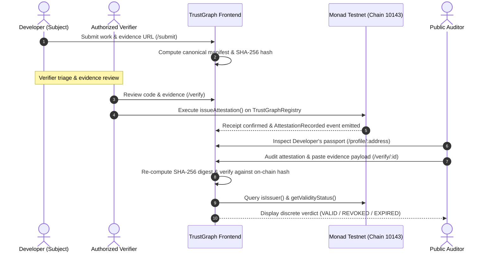
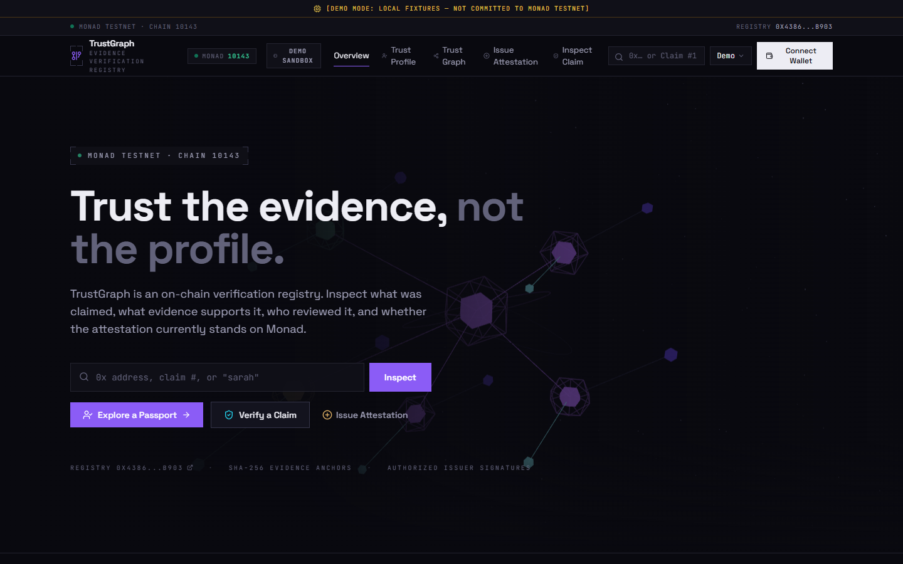
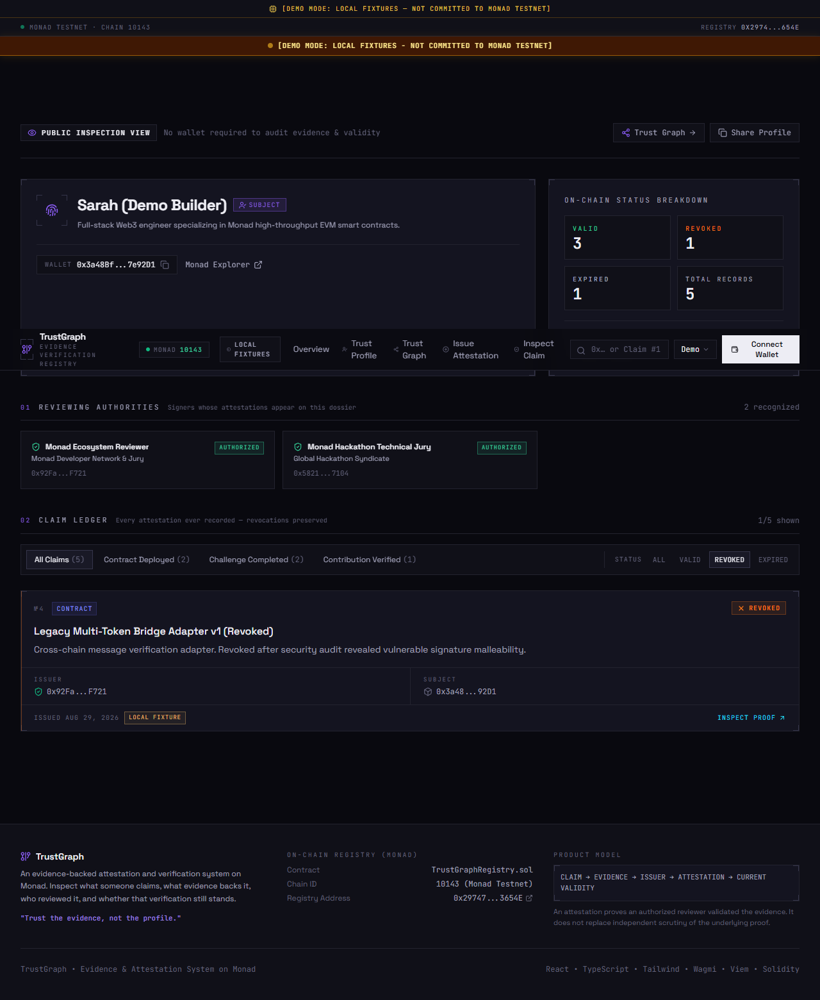
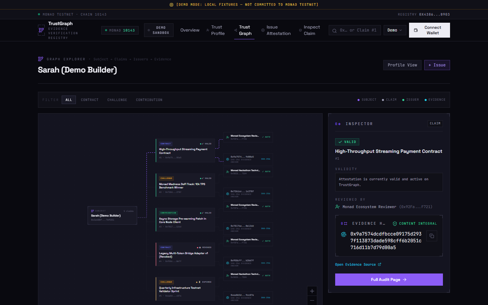
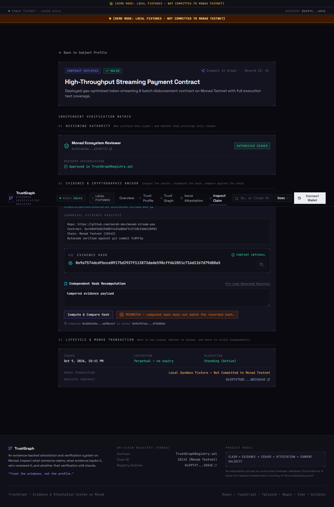
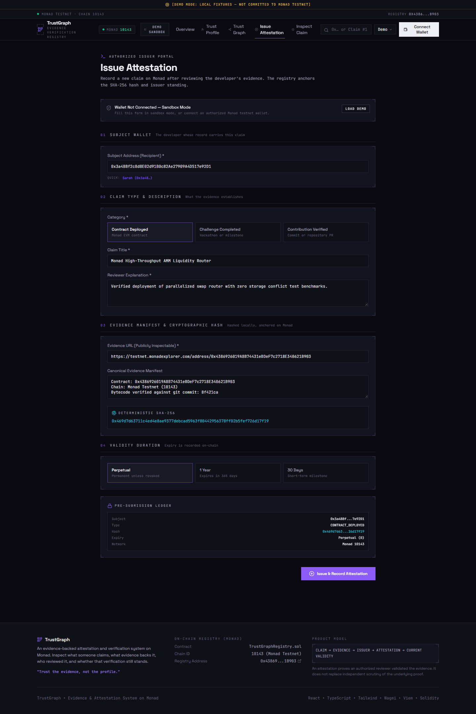
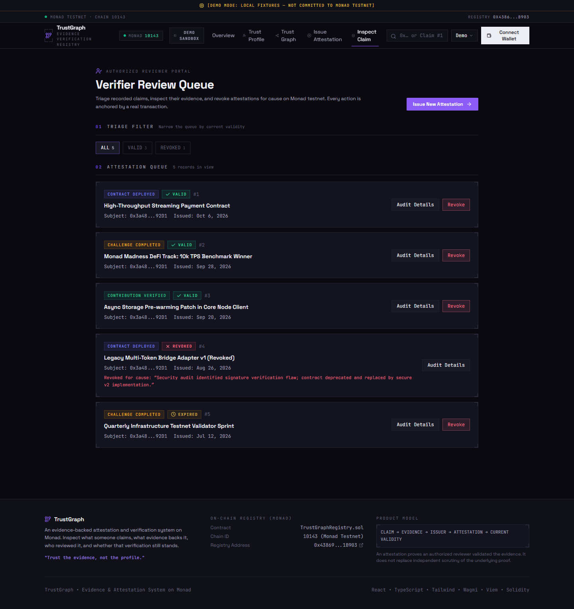
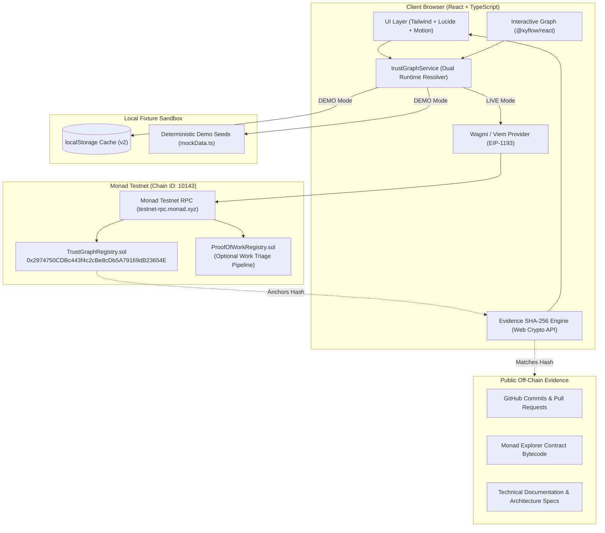

# TrustGraph

> **Trust the evidence, not the profile.**  
> *"Don't tell people what you can do. Show them what you've actually done."*

TrustGraph is an evidence-backed attestation and verification system built on **Monad**. Designed for developers, hackathon participants, and ecosystem contributors, it converts technical claims into tamper-evident, cryptographically anchored records verified by authorized issuers.

Built for **Monad Blitz Pune V3**, TrustGraph replaces arbitrary, gameable reputation scores, XP systems, and superficial social profiles with an auditable proof-of-work passport.

---

## Table of Contents

1. [The Problem & The Solution](#1-the-problem--the-solution)
2. [Key Features](#2-key-features)
3. [How It Works](#3-how-it-works)
4. [Screenshots & Visual Tour](#4-screenshots--visual-tour)
5. [Technology Stack](#5-technology-stack)
6. [System Architecture](#6-system-architecture)
7. [Repository Structure](#7-repository-structure)
8. [Prerequisites](#8-prerequisites)
9. [Installation & Local Development](#9-installation--local-development)
10. [Environment Configuration](#10-environment-configuration)
11. [Smart Contracts](#11-smart-contracts)
12. [Monad Testnet Deployment](#12-monad-testnet-deployment)
13. [Demo Mode vs. Live Testnet Mode](#13-demo-mode-vs-live-testnet-mode)
14. [Testing & Verification](#14-testing--verification)
15. [Security Considerations & Limitations](#15-security-considerations--limitations)
16. [Roadmap](#16-roadmap)
17. [License & Acknowledgements](#17-license--acknowledgements)

---

## 1. The Problem & The Solution

### The Problem
Traditional developer credentials and Web3 profiles are plagued by three systemic failures:
1. **Unverifiable Claims:** Resumes, GitHub bios, and LinkedIn profiles allow anyone to claim they built high-throughput systems, deployed contracts, or won hackathons without inspectable evidence.
2. **Gameable Metrics & "Karma":** Vanity metrics (followers, badges, points, XP, or tokenized reputation) reward social engineering and platform farming rather than verified technical execution.
3. **No Provenance or Revocation Lifecycle:** Once a credential is given, there is rarely a decentralized mechanism to verify who authorized it, what raw artifact was inspected, whether the credential expired, or whether it was revoked due to a security vulnerability.

### The Solution: TrustGraph
TrustGraph answers one fundamental question:
> **"Why should I trust this claim about this person?"**

It enforces a strict, mathematical verification lifecycle:
```text
WORK / CLAIM  ──>  EVIDENCE  ──>  AUTHORIZED VERIFIER  ──>  ON-CHAIN PROOF  ──>  PUBLIC AUDIT
```

- **Evidence First:** Every claim requires an off-chain canonical evidence manifest and a cryptographic SHA-256 digest anchored on Monad.
- **Authorized Reviewers:** Only authorized issuers (verified ecosystem judges, protocol core devs, security reviewers) can issue or revoke attestations.
- **Discrete Validity States:** Never a fuzzy score. A record is deterministically evaluated as `VALID`, `REVOKED`, `EXPIRED`, or `INVALID_ISSUER`.
- **Public Auditing Without Wallets:** Anyone can inspect proofs, run the built-in evidence hashing widget, and verify ledger provenance without connecting a wallet.

---

## 2. Key Features

| Feature | Description | Status |
| --- | --- | --- |
| **Public Trust Passport** (`/profile/:address`) | Public profile displaying all verified claims for an address, authorized reviewing authorities, and status breakdowns. Zero arbitrary numerical scores or XP. | **Implemented & Verified** |
| **Issue Attestation** (`/issue`) | Restricted interface for authorized issuers to issue attestations with live browser-based SHA-256 calculation and pre-submission ledger inspection. | **Implemented & Verified** |
| **Developer Work Submission** (`/submit`) | Portal for builders to submit completed work (smart contracts, pull requests, hackathon projects) with canonical manifests for reviewer triage. | **Implemented & Verified** |
| **Interactive Trust Graph** (`/graph/:address`) | Node-link graph visualization powered by `@xyflow/react` connecting Subjects, Claims, Issuers, and Evidence with inspection side-drawers. | **Implemented & Verified** |
| **Verification Detail Surface** (`/verify/:id`) | Independent 7-question audit page with a built-in SHA-256 verification widget, expiration calculations, and revocation history. | **Implemented & Verified** |
| **Verifier Dashboard Queue** (`/verify`) | Triage workstation for authorized ecosystem reviewers to evaluate pending developer submissions, approve, or reject with rationale. | **Implemented & Verified** |
| **Client-Side SHA-256 Hash Verification** | Embedded Web Crypto API widget that recomputes artifact digests in real time to detect tampered or altered evidence payloads. | **Implemented & Verified** |
| **Dual Runtime (Demo vs. Live Testnet)** | Seamless toggle between instant local sandbox fixtures (`Sarah`, `Reviewer`, `Organizer`) and live Monad Testnet contract transactions. | **Implemented & Verified** |

### Supported Claim Types
- `CONTRACT_DEPLOYED` — Verified on-chain smart contract deployment on Monad Testnet with verified bytecode.
- `CHALLENGE_COMPLETED` — Completed hackathon project, CTF challenge, or technical milestone evaluated by an authorized jury.
- `CONTRIBUTION_VERIFIED` — Peer-reviewed open-source repository commit, pull request, or security patch.

---

## 3. How It Works



### The Core Architectural Distinction:
> **An on-chain attestation proves that an authorized issuer reviewed the evidence and registered that record on Monad. It does not magically make the underlying claim universally true.**

TrustGraph does not claim omniscience. Instead, it makes the **evidence**, the **cryptographic hash**, and the **identity and authority of the reviewer** completely transparent and permanently verifiable.

---

## 4. Screenshots & Visual Tour

Actual application screenshots captured from local runs:

### Overview & Exploration

*Landing page with instant address search, protocol metrics on Monad Testnet, and recent attestations.*

---

### Public Trust Profile

*Public developer passport for Sarah (`0x3a48...`) showing verified claims, authorized reviewing authorities, and validity breakdowns.*

---

### Interactive Trust Graph

*Interactive graph connecting Subject wallet, issued attestations, reviewing issuers, and off-chain evidence nodes.*

---

### Verification Detail & SHA-256 Hash Matching

*Seven-point auditing surface with client-side SHA-256 evidence matcher and full revocation tracking.*

---

### Authorized Attestation Issuance

*Authorized issuer terminal with real-time manifest preview, SHA-256 digest calculation, and transaction stage tracker.*

---

### Verifier Review Queue

*Triage dashboard for verifiers to inspect pending developer submissions and issue attestations.*

---

## 5. Technology Stack

### Frontend & Visual System
- **Framework:** React 18 (`react`, `react-dom`) with TypeScript 5.7
- **Build Tool:** Vite 6
- **Styling:** Tailwind CSS 3.4 (`tailwindcss`, `@tailwindcss/forms`), Vanilla CSS custom variables, `clsx`, `tailwind-merge`
- **Graph Visualization:** `@xyflow/react` (React Flow 12) with custom industrial node designs and interactive edges
- **3D Interactive Visuals:** Three.js (`three`), `@react-three/fiber`, `@react-three/drei`
- **Icons & Motion:** Lucide React (`lucide-react`), Motion (`motion` 14)
- **Routing:** React Router DOM 6 (`react-router-dom`)

### Web3 & Blockchain Integration
- **Target Network:** Monad Testnet (Chain ID `10143`)
- **Ethereum Client:** Viem 2.57
- **Wallet Connection:** Wagmi 3.7 (`wagmi`, `@tanstack/react-query`)
- **Cryptography:** Native browser Web Crypto API (`crypto.subtle.digest`) for live client-side SHA-256 calculations

### Smart Contracts & Development Tooling
- **Language:** Solidity `^0.8.20` / `^0.8.28`
- **Development Environment:** Hardhat 3 (`hardhat`, `@nomicfoundation/hardhat-toolbox`)
- **Compilers:** `solc 0.8.28` (optimizer enabled, 200 runs)
- **Deployment Automation:** Custom Viem deployment scripts (`scripts/deploy.cjs`, `scripts/deploy.ts`)
- **Testing:** Node.js native test runner (`node --experimental-strip-types`) and Hardhat test suite

---

## 6. System Architecture



---

## 7. Repository Structure

```text
trust-graph/
├── contracts/                        # Solidity smart contracts
│   ├── TrustGraphRegistry.sol        # Primary on-chain attestation registry (Deployed on Monad)
│   ├── ProofOfWorkRegistry.sol       # Developer work submission & verification registry (Tested & ready)
│   └── TrustGraphRegistry.json       # Compiled contract ABI & bytecode artifact
├── server/                           # Express Backend & MongoDB Persistence
│   ├── src/
│   │   ├── config/env.ts             # Typed environment configuration
│   │   ├── controllers/              # Auth & submission business logic controllers
│   │   ├── middleware/auth.ts        # JWT cookie authentication & route security
│   │   ├── models/                   # Mongoose schemas (User, WorkSubmission)
│   │   ├── routes/                   # RESTful API routes (/api/auth, /api/submissions)
│   │   ├── app.ts                    # Express application instance & middleware
│   │   └── index.ts                  # Backend server entry point (port 5001)
│   └── test/backend.test.ts          # Comprehensive Mocha tests with in-memory MongoDB
├── src/                              # Frontend source code (React 18 + Vite)
│   ├── components/                   # Reusable UI components & AuthModal
│   ├── contexts/AuthContext.tsx      # Authentication state, session restoration & EIP-191 linking
│   ├── hooks/                        # Custom Wagmi/React hooks
│   ├── pages/                        # Primary application routes
│   └── services/api.ts               # Authenticated REST API client with credentials: 'include'
├── test/                             # Automated test suites (Contracts & Invariants)
├── package.json                      # Full-stack scripts & dependencies
└── vite.config.ts                    # Vite build configuration
```

---

## 8. Prerequisites

- **Node.js:** `>= 20.x` or `22.x` (Recommended: Node.js 22.x)
- **MongoDB:** Local MongoDB instance (`mongodb://localhost:27017/trustgraph`) or MongoDB Atlas connection string. (For testing, in-memory MongoDB is used automatically).
- **Web Browser:** Modern browser (Chrome, Brave, Firefox, Edge) with an EVM wallet extension (e.g. MetaMask, Rabby) for Monad Testnet transactions.
- *Note:* Public auditing, passport inspection, and evidence verification do **not** require any browser wallet or login.

---

## 9. Installation & Startup Instructions

### 1. Clone the repository & install dependencies
```bash
git clone https://github.com/dinesh-nikam/trust-graph.git
cd trust-graph
npm install
```

### 2. Configure environment variables
```bash
cp .env.example .env
```
Ensure your `.env` contains:
```env
PORT=5001
MONGODB_URI=mongodb://localhost:27017/trustgraph
JWT_SECRET=trustgraph_super_secure_jwt_secret_development_key_change_in_prod
CLIENT_ORIGIN=http://localhost:5173
VITE_API_URL=http://localhost:5001
VITE_MONAD_RPC_URL=https://testnet-rpc.monad.xyz
VITE_TRUST_GRAPH_REGISTRY_ADDRESS=0x2974750CDBc443f4c2cBe8cDb5A79169dB23654E
VITE_APP_MODE=live
```

### 3. Start the Backend Server
```bash
# Production / standard mode
npm run server

# Development mode (with file watcher)
npm run server:dev
```
Backend health check: `http://localhost:5001/api/health`

### 4. Start the Frontend Application
In a separate terminal:
```bash
npm run dev
```
Open `http://localhost:5173` in your browser.

---

## 10. Authentication & Wallet Linking Lifecycle

TrustGraph follows strict authentication hygiene:
1. **User Identity:** Users register with Name, Email, Password, and optional Username. Passwords are securely hashed with `bcryptjs`.
2. **Session Security:** Authenticated sessions use signed JWT tokens stored in `HttpOnly`, `SameSite=Lax` cookies (`trustgraph_jwt`). Tokens are **never** stored in `localStorage`.
3. **Cryptographic EIP-191 Wallet Linking:**
   - Client requests a one-time cryptographic nonce from `GET /api/auth/wallet-nonce`.
   - Connected Web3 wallet (via Wagmi) signs the personal challenge message.
   - Backend cryptographically recovers the signer address via Viem `verifyMessage()`.
   - The verified address is bound to the user's account in MongoDB.

---

## 11. Environment Configuration

All variables are documented in `.env.example`:

| Variable | Required | Default / Example | Purpose |
| --- | --- | --- | --- |
| `PORT` | Yes | `5001` | Express backend server port. |
| `MONGODB_URI` | Yes | `mongodb://localhost:27017/trustgraph` | MongoDB connection string. |
| `JWT_SECRET` | Yes | *(Secret string)* | Secret key for signing session JWT cookies. |
| `CLIENT_ORIGIN` | Yes | `http://localhost:5173` | Allowed CORS origin with credentials. |
| `VITE_API_URL` | Yes | `http://localhost:5001` | Frontend API client base URL. |
| `VITE_MONAD_RPC_URL` | No | `https://testnet-rpc.monad.xyz` | Monad Testnet JSON-RPC endpoint. |
| `VITE_TRUST_GRAPH_REGISTRY_ADDRESS` | Yes | `0x2974750CDBc443f4c2cBe8cDb5A79169dB23654E` | Live `TrustGraphRegistry` contract address. |
| `VITE_PROOF_OF_WORK_REGISTRY_ADDRESS` | No | *(Zero address or configured)* | `ProofOfWorkRegistry` contract address. |
| `VITE_APP_MODE` | No | `live` | Runtime execution mode (`live` or `demo`). |

---

## 12. Automated Testing Suite

The project includes 4 layers of automated tests:

```bash
# 1. Backend & MongoDB integration tests (16 tests)
npm run test:server

# 2. Solidity unit & Hardhat contracts tests (167 tests)
npm test

# 3. Full EVM on-chain integration tests
npm run test:integration

# 4. Strict TypeScript typechecking (frontend & backend)
npm run typecheck

# 5. Production bundle build
npm run build
```

---

## 11. Smart Contracts

TrustGraph includes two complementary smart contracts:

### 1. `TrustGraphRegistry.sol` *(Authoritative Attestation Registry)*
Manages authorized issuers, attestation records, validity status, and revocations.

#### Attestation Data Model
```solidity
struct Attestation {
    uint256 id;               // Sequential identifier starting at 1
    address issuer;           // Authorized reviewer address
    address subject;          // Developer / recipient address
    bytes32 claimType;        // UTF-8 bytes32 (e.g. CONTRACT_DEPLOYED)
    bytes32 evidenceHash;     // SHA-256 cryptographic hash of evidence manifest
    string evidenceUri;       // Off-chain URI (URL or IPFS CID)
    uint256 issuedAt;         // Block timestamp at issuance
    uint256 expiry;           // Unix timestamp (0 = perpetual / non-expiring)
    bool revoked;             // Revocation flag
    string revocationReason;  // Human-readable reason for revocation
}
```

#### Discrete Validity States
```solidity
enum ValidityStatus {
    NOT_FOUND,       // Record does not exist in registry
    VALID,           // Active, unrevoked, unexpired, issuer currently authorized
    REVOKED,         // Explicitly revoked by issuer or registry owner
    EXPIRED,         // Past block timestamp expiry
    INVALID_ISSUER   // Issuer's authority was subsequently removed by registry owner
}
```

#### Key Methods
- `approveIssuer(address issuer)` — *(onlyOwner)* Grants an address permission to issue attestations.
- `removeIssuer(address issuer)` — *(onlyOwner)* Revokes issuer status. Immediately cascades to make all previously issued attestations return `INVALID_ISSUER`.
- `isIssuer(address issuer) returns (bool)` — Checks active issuer authorization.
- `issueAttestation(address subject, bytes32 claimType, bytes32 evidenceHash, string evidenceUri, uint256 expiry) returns (uint256)` — *(onlyIssuer)* Records a new attestation on Monad.
- `revokeAttestation(uint256 id, string reason)` — Revokes an attestation with a mandatory rationale. Only callable by the original issuer or the registry owner. Preserves the full historical record on-chain.
- `getValidityStatus(uint256 id) returns (ValidityStatus)` — Evaluates current validity using block timestamp and active issuer standing.

---

### 2. `ProofOfWorkRegistry.sol` *(Developer Work Triage Pipeline)*
Manages developer submissions through a formal finite state machine:
```text
NON_EXISTENT  ──>  PENDING  ──>  VERIFIED  ──>  REVOKED
                      │
                      └──>  REJECTED
```
Illegal state transitions (e.g. `REJECTED -> VERIFIED` or `PENDING -> REVOKED`) revert on-chain.

---

## 12. Monad Testnet Deployment

`TrustGraphRegistry` is verified and live on **Monad Testnet**:

| Parameter | Monad Testnet Value |
| --- | --- |
| **Network Name** | Monad Testnet |
| **Chain ID** | `10143` |
| **Contract Address** | `0x2974750CDBc443f4c2cBe8cDb5A79169dB23654E` |
| **Deployer / Owner** | `0x132187B44d6dB6913BD2FB2C664A8c94C63485ac` |
| **Deployment Transaction** | `0xe99b2b0ae819c650820b698c06f09eebc50dc5e362afcd3a33624f28ec4485ff` |
| **Deployment Block** | `69802176` |
| **Block Explorer URL** | [View on MonadVision Explorer](https://testnet.monadvision.com/address/0x2974750CDBc443f4c2cBe8cDb5A79169dB23654E) |

### Deploying or Re-deploying
To deploy the registry yourself using testnet MON:
```bash
# Set your deployer key in the Hardhat keystore (recommended):
npx hardhat keystore set DEPLOYER_PRIVATE_KEY

# Deploy TrustGraphRegistry to Monad Testnet
npm run contracts:deploy:testnet

# Or deploy via custom Viem script
npm run deploy

# Verify on-chain deployment & bytecode
npm run contracts:check:testnet
```

---

## 13. Demo Mode vs. Live Testnet Mode

TrustGraph features a strict **Honesty Invariant** to eliminate fake blockchain transactions or fabricated UI states:

| Dimension | DEMO MODE (Local Sandbox) | LIVE MODE (Monad Testnet) |
| --- | --- | --- |
| **Visual Banner** | Amber indicator: `[DEMO MODE: LOCAL FIXTURES - NOT COMMITTED TO MONAD TESTNET]` | Emerald indicator: `MONAD TESTNET CONFIGURED (Chain ID: 10143) · REGISTRY: 0x2974...` |
| **Data Source** | Seeded deterministic records (`MOCK_ATTESTATIONS` in `src/data/mockData.ts`) cached in `localStorage`. | Live on-chain queries via Viem `publicClient.readContract` on Monad Testnet. |
| **Issuance** | Saves record to local sandbox state with simulated timestamps. Zero fake transaction hashes are displayed. | Broadcasts transaction to Monad Testnet, waits for receipt confirmation, and records block number. |
| **Wallet Requirement**| None. Any of the three demo personas can be tested immediately. | Requires an active EVM wallet connected to Chain ID `10143` with testnet MON for gas. |

### Built-In Demo Personas
- **Developer (Subject):** `0x3a48Bf2c8d8E02d91B0c82Ae27909A4D517e92D1` (*Sarah*) — Builder with claims backed by inspectable smart contract and commit evidence.
- **Reviewer (Authorized Issuer):** `0x92Fa656bE0656D1F08a6eD7D284976d8b948F721` (*Ecosystem Reviewer*) — Authorized to review evidence manifests and issue attestations.
- **Organizer (Admin / Owner):** `0x72A14b98c368d19F58bFE4e7d4d4D91F2610A91F` (*Alex*) — Registry owner authorized to approve and remove issuers.

---

## 14. Testing & Verification

The repository includes a comprehensive, dependency-free test harness covering mathematical state machines, canonical normalization, and error translation:

### 1. Run Unit & Invariant Test Suite
```bash
npm run test:unit
```
Executes `test/trustGraph.test.ts` using Node.js native TypeScript stripping:
- **Canonical Normalization Protocol:** Verifies whitespace trimming, case normalization, and consistent SHA-256 generation across payloads.
- **Lifecycle Invariants:** Verifies legal state transitions (`PENDING -> VERIFIED`, `PENDING -> REJECTED`, `VERIFIED -> REVOKED`) and confirms illegal transitions revert.
- **Mandatory Revocation Reasons:** Verifies that revocations and rejections enforce non-empty rationales.
- **De-authorized Issuer Cascading:** Verifies that removing issuer authorization propagates `INVALID_ISSUER` status.

### 2. Run Hackathon-Readiness Test Suite
```bash
node --experimental-strip-types test/readiness.test.ts
```
- Section A: Verifies transaction error translations (`userRejected`, `insufficientFunds`, `reverted`).
- Section B: Recomputes SHA-256 digests for all 6 demo fixtures against their canonical manifests and verifies zero fake transaction hashes exist.
- Section C: Simulates transaction receipt lifecycle branches (`preparing` -> `waiting-wallet` -> `submitted` -> `confirming` -> `confirmed`).

### 3. Run Full Automated Test Command
```bash
npm test
```

### 4. Smart Contract Tests (Hardhat)
```bash
npm run contracts:test
```

---

## 15. Security Considerations & Limitations

1. **Evidence Integrity vs. Truth:** A matching SHA-256 hash proves that the inspected evidence payload is identical to the one reviewed by the issuer. It does **not** replace the human diligence of the verifier. TrustGraph anchors accountability, not absolute truth.
2. **Cascading Authorization Invalidation:** If an authorized reviewer is compromised or found to have issued malicious claims, the registry owner removes their address via `removeIssuer()`. All attestations issued by that address immediately resolve to `INVALID_ISSUER` upon next query.
3. **Preservation of Revoked Records:** Revoking an attestation **never deletes** the record from Monad. The historical record, the original evidence hash, the revoker's address, and the mandatory revocation reason remain permanently inspectable for auditability.
4. **No Sensitive PII On-Chain:** TrustGraph only stores wallet addresses, byte32 digests, and public URIs. Personal identifying information, private keys, and sensitive code should never be included in the evidence manifest.
5. **Audit Disclaimer:** TrustGraph is experimental software built for Monad Blitz Pune V3. It has not undergone an independent third-party cryptographic security audit and should not be used as the sole authorization gate for high-value mainnet custody.

---

## 16. Roadmap

- [x] On-chain Attestation Registry with discrete validity states (`TrustGraphRegistry.sol`)
- [x] Deterministic browser SHA-256 evidence hashing and client-side verification widget
- [x] Interactive node-link Trust Graph visualization (`@xyflow/react`)
- [x] Dual-mode runtime (Local fixture sandbox vs. live Monad Testnet)
- [x] 7-question independent verification audit surface
- [ ] **Multi-Tenant Workspaces:** Support for organizational teams, DAOs, and hackathon organizers to maintain segregated verifier pools.
- [ ] **Automated CI/CD Oracles:** GitHub Actions bot and automated oracles to attest to commit signatures and test suite pass rates.
- [ ] **Decentralized Storage Anchoring:** Direct IPFS / Arweave pinning for evidence manifests within the issuance workflow.
- [ ] **Revocation Challenge Protocol:** Community dispute resolution mechanism allowing subjects to contest contested revocations.

---

## 17. License & Acknowledgements

This project is licensed under the **MIT License**.

Built with pride for **Monad Blitz Pune V3** 💜. Special thanks to the Monad community, builders, and ecosystem contributors pushing the boundaries of parallelized EVM execution.
